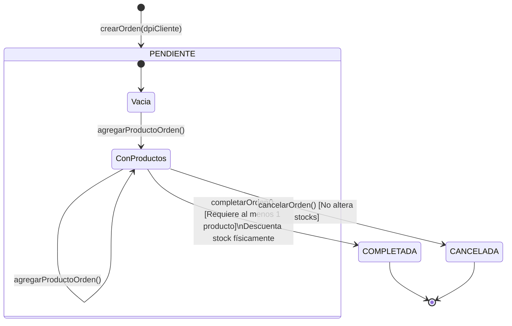

# MANUAL TÉCNICO DE ARQUITECTURA Y DESARROLLO DE SOFTWARE
## Sistema Integral de Gestión de Ventas e Inventario Multidepósito (SVI)

---

**Documento:** Manual Técnico de Ingeniería de Software  
**Proyecto:** Sistema de Gestión de Ventas e Inventario (SVI)  
**Versión:** 1.0.0  
**Fecha:** Noviembre 2026  
**Lenguaje de Programación:** Java SE 17+ (LTS)  
**Entorno de Ejecución Objetivo:** Windows 10/11, macOS, Linux  
**Clasificación:** Documentación Técnica de Nivel Académico y Profesional  

---

## 1. Portada y Resumen Ejecutivo del Proyecto

### 1.1 Introducción y Justificación
En el contexto del desarrollo de software empresarial y los cursos avanzados de Programación Orientada a Objetos (POO) e Ingeniería de Software, la construcción de soluciones autónomas que garanticen la integridad referencial, el aislamiento transaccional y la persistencia confiable de datos —sin depender necesariamente de un Sistema Gestor de Bases de Datos Relacionales (RDBMS) externo— representa un desafío técnico de alto impacto formativo y aplicativo.

El **Sistema Integral de Gestión de Ventas e Inventario Multidepósito (SVI)** es una aplicación cliente de escritorio diseñada bajo los paradigmas rigurosos de la Orientación a Objetos en Java. Su propósito fundamental es centralizar, optimizar y auditar el ciclo de vida de operaciones comerciales en organizaciones que operan con almacenamiento distribuido en múltiples bodegas físicas.

El aplicativo proporciona capacidades integrales para:
1. La catalogación y parametrización de mercancías (productos).
2. El padrón de clientes clasificados por categorías comerciales (Regular y VIP).
3. La nómina y asignación de personal operativo y administrativo (empleados).
4. La distribución y administración de centros de acopio (bodegas físicas) con control de capacidades volumétricas.
5. El control estricto de existencias (stock) por bodega con prevención matemática de desbordamientos.
6. El procesamiento transaccional de órdenes de compra con reservas en tiempo real y descuentos automáticos de inventario.

### 1.2 Problemática Resuelta
En arquitecturas de software sin infraestructura cliente-servidor o bases de datos dedicadas, los sistemas suelen sucumbir ante fallas comunes:
- Corrupción de datos por interrupciones abruptas de energía durante la escritura en disco.
- Bloqueos de archivos (*file locking*) característicos del sistema de archivos NTFS en sistemas operativos Microsoft Windows.
- Sobregiro (*overdraft*) de inventario cuando una orden de venta consolida múltiples renglones de stock de distintas ubicaciones físicas.
- Inconsistencia de punteros o referencias a entidades inexistentes (e.g., asignar un empleado inexistente a una bodega, o vender a un cliente no registrado).

El sistema SVI resuelve de raíz estas vulnerabilidades mediante un diseño arquitectónico estratificado, incorporando un mecanismo transaccional de guardado atómico en tres fases (`.tmp`, `.dat`, `.bak`), validaciones precondicionales en todos los métodos mutadores de entidad, y una fachada centralizada (`SistemaVentas`) que actúa como guardián de la integridad referencial.

### 1.3 Objetivos Técnicos del Proyecto
- **Modularidad y Alta Cohesión:** Estructurar las responsabilidades en capas lógicas bien definidas: Dominio, Persistencia, Servicios/Fachada y Presentación gráfica (Swing).
- **Encapsulamiento Defensivo:** Evitar la fuga de referencias mutables hacia la interfaz de usuario mediante colecciones inmutables (`Collections.unmodifiableList`) y copias defensivas.
- **Tolerancia a Fallos y Autorrecuperación:** Proveer un subsistema de E/S binario capaz de detectar corrupción en el archivo maestro y restaurar automáticamente la última instantánea válida desde una copia de respaldo.
- **Validación Estricta del Dominio:** Asegurar que ningún objeto entre en un estado inválido (verificación de identificadores nacionales como el DPI guatemalteco de 13 dígitos, precios y salarios no negativos, capacidad finita de bodegas).

---

## 2. Especificación de Requerimientos Técnicos y de Entorno

### 2.1 Requerimientos de Software
| Componente | Especificación Mínima | Especificación Recomendada | Notas Técnicas |
| :--- | :--- | :--- | :--- |
| **Java Development Kit (JDK)** | OpenJDK / Oracle JDK 17 LTS | JDK 21 LTS o superior | Requiere soporte para APIs modernas de `java.nio.file` y colecciones mejoradas. |
| **Sistema Operativo** | Windows 10 (64-bit), macOS 12 Monterey, Ubuntu 20.04 LTS | Windows 11 Pro / Enterprise (x64 o ARM64) | Totalmente adaptado para sortear restricciones de bloqueo de archivos en Windows NTFS. |
| **Arquitectura de CPU** | x86_64 (amd64) / AArch64 (Apple Silicon / ARM64) | x86_64 o Apple M-Series | Sin dependencias nativas (JNI/JNA), 100% Java puro portable. |
| **Codificación de Caracteres** | UTF-8 | UTF-8 | Crítico para acentos, caracteres latinos y símbolos monetarios (`Q` de Quetzal). |

### 2.2 Requerimientos de Hardware
- **Memoria RAM:** Mínimo 2 GB disponibles (512 MB asignados a la Java Virtual Machine mediante `-Xmx512m`). Recomendado 4 GB o superior.
- **Almacenamiento en Disco:** 100 MB de espacio disponible para el entorno de ejecución, binarios compilados y directorio de datos (`datos/`).
- **Pantalla y Adaptador Gráfico:** Resolución mínima de 1024x768 píxeles. La interfaz gráfica Swing ha sido dimensionada a 900x600 píxeles con centrado dinámico en pantalla y soporte para escalado DPI de Windows.

### 2.3 Configuración de Variables de Entorno en Windows
Para garantizar la compilación y ejecución directa desde la consola (PowerShell o Símbolo del Sistema / CMD), deben configurarse las siguientes variables de entorno del sistema:

1. **`JAVA_HOME`:**
   Ruta absoluta hacia el directorio raíz de la instalación del JDK.
   - *Ejemplo típico:* `C:\Program Files\Eclipse Adoptium\jdk-17.0.10.7-hotspot\` o `C:\Program Files\Java\jdk-17`
2. **`Path`:**
   Debe contener la entrada `%JAVA_HOME%\bin` al principio de la lista de rutas del sistema.

#### Verificación en PowerShell:
```powershell
# Verificar versión del compilador Java
javac -version
# Salida esperada: javac 17.0.x (o superior)

# Verificar máquina virtual Java
java -version
# Salida esperada: openjdk version "17.0.x" ... Runtime Environment ... 64-Bit Server VM
```

### 2.4 Procedimiento de Compilación y Ejecución por Línea de Comandos

El proyecto utiliza la estructura canónica de paquetes de Java. A continuación se presentan las instrucciones paso a paso para compilar y ejecutar el software desde la terminal de Windows o PowerShell.

#### Estructura del Directorio de Trabajo:
```text
sistemaventas/
├── bin/                       <-- Directorio de salida de archivos .class
├── datos/                     <-- Almacén de persistencia (creado en runtime)
│   ├── sistema.dat
│   ├── sistema.tmp
│   └── sistema.bak
├── docs/                      <-- Manuales y documentación técnica
│   └── MANUAL_TECNICO.md
└── sistemaventas/             <-- Código fuente Java (paquete sistemaventas)
    ├── ArchivoService.java
    ├── Bodega.java
    ├── Cliente.java
    ├── Empleado.java
    ├── EstadoSistema.java
    ├── EstiloUI.java
    ├── Existencia.java
    ├── Main.java
    ├── OrdenCompra.java
    ├── Producto.java
    ├── SistemaVentas.java
    ├── Validaciones.java
    └── VentanaPrincipal.java
```

#### Comandos de Compilación (desde la raíz del proyecto `sistemaventas`):
En PowerShell o CMD:
```powershell
# 1. Crear el directorio de binarios compilados si no existe
if (!(Test-Path bin)) { New-Item -ItemType Directory -Path bin }

# 2. Compilar todas las clases del paquete sistemaventas hacia la carpeta bin
javac -encoding UTF-8 -d bin sistemaventas/*.java
```

#### Comandos de Ejecución:
```powershell
# Ejecutar la aplicación especificando el classpath a la carpeta de binarios
java -cp bin sistemaventas.Main
```

#### Empaquetado en un Archivo JAR Ejecutable Autónomo:
```powershell
# Crear manifiesto temporal con la clase principal definida
Set-Content -Path manifest.txt -Value "Main-Class: sistemaventas.Main`n"

# Generar archivo JAR con los binarios compilados
jar cfm SistemaVentas.jar manifest.txt -C bin .

# Ejecución directa del JAR distribuible
java -jar SistemaVentas.jar
```

---

## 3. Arquitectura del Sistema y Patrones de Diseño

El sistema está estructurado siguiendo una arquitectura desacoplada en capas inspirada en el patrón **Modelo-Servicio-Vista (Variación de MVC)**, asegurando la separación clara de responsabilidades (*Separation of Concerns*) y la facilidad de mantenimiento y pruebas unitarias.

```text
┌────────────────────────────────────────────────────────┐
│                   CAPA DE PRESENTACIÓN                 │
│      VentanaPrincipal (JFrame)  +  EstiloUI (Look&Feel) │
└───────────────────────────┬────────────────────────────┘
                            │ (Invocaciones / Eventos GUI)
                            ▼
┌────────────────────────────────────────────────────────┐
│                CAPA DE SERVICIOS Y NEGOCIO             │
│            SistemaVentas (Fachada del Sistema)         │
│          - Validaciones de Integridad Referencial      │
│          - Orquestación de Transacciones y Rollback    │
└───────────────┬────────────────────────┬───────────────┘
                │                        │
       (Snapshot en memoria)     (I/O Binario Atómico)
                ▼                        ▼
┌───────────────────────────┐ ┌──────────────────────────┐
│      CAPA DE DOMINIO      │ │   CAPA DE PERSISTENCIA   │
│   EstadoSistema           │ │   ArchivoService         │
│   - Producto, Cliente     │ │   - ObjectOutputStream   │
│   - Empleado, Bodega      │ │   - ObjectInputStream    │
│   - Existencia, Orden     │ │   - .tmp -> .dat -> .bak │
└───────────────────────────┘ └──────────────────────────┘
```

### 3.1 Estructura en Capas

1. **Capa de Dominio / Entidades:**
   Representada por las clases `Producto`, `Cliente`, `Empleado`, `Bodega`, `Existencia`, `OrdenCompra` y el contenedor agregado `EstadoSistema`. Cada una implementa la interfaz `java.io.Serializable`. Poseen encapsulamiento estricto, métodos mutadores que validan invariantes de forma inmediata y métodos de apoyo para operaciones atómicas locales (e.g. `Existencia.agregar`, `Existencia.descontar`, `OrdenCompra.agregarProducto`).

2. **Capa de Persistencia (DAO / Data Access Service):**
   Implementada por `ArchivoService`. Aísla todas las operaciones de entrada/salida física (`java.nio.file.Files`, `ObjectInputStream`, `ObjectOutputStream`). La lógica de negocio desconoce la estructura de archivos en disco, comunicándose con esta capa únicamente a través del traspaso del objeto `EstadoSistema`.

3. **Capa de Lógica de Negocio y Coordinación (Fachada / Service):**
   Implementada por `SistemaVentas`. Centraliza todas las reglas de negocio, garantiza la integridad referencial antes de registrar o alterar entidades y maneja la atomicidad en memoria. Si la persistencia física falla durante cualquier operación, esta capa revierte de inmediato los cambios aplicados a las colecciones en memoria.

4. **Capa de Presentación (Vista):**
   Implementada por `VentanaPrincipal` (subclase de `javax.swing.JFrame`), asistida por `EstiloUI`. Desacoplada del almacenamiento, interactúa exclusivamente con los métodos públicos de `SistemaVentas`. Maneja de forma controlada todas las excepciones (`IllegalArgumentException`, `IllegalStateException`, `IOException`) transformándolas en alertas amigables al usuario mediante cuadros de diálogo modales (`JOptionPane`).

---

### 3.2 Patrones de Diseño de Software Aplicados

#### 3.2.1 Patrón Fachada (*Facade Pattern*)
- **Clase Responsable:** `sistemaventas.SistemaVentas`
- **Motivación:** La manipulación del sistema involucra múltiples subsistemas: listas independientes de productos, bodegas, clientes, existencias ligadas a almacenes, órdenes de compra y el servicio de serialización en disco. Si la interfaz gráfica tuviese que gestionar individualmente cada lista y llamar a la persistencia, el código visual quedaría fuertemente acoplado y expuesto a estados inconsistentes.
- **Implementación:** `SistemaVentas` oculta toda la complejidad estructural. La vista solo ejecuta llamadas semánticas de alto nivel como `sistema.registrarBodega(b)`, `sistema.agregarStock(cod, bod, cant)` o `sistema.completarOrden(id)`.

#### 3.2.2 Patrón de Servicio de Persistencia / Objeto de Acceso a Datos (*Data Access Service*)
- **Clase Responsable:** `sistemaventas.ArchivoService`
- **Motivación:** Centralizar la política de serialización binaria, las rutas de almacenamiento, el protocolo de guardado en tres fases y las maniobras de recuperación de archivos corruptos en una única clase especializada.
- **Beneficio:** Si en el futuro se sustituye la serialización binaria por una base de datos relacional (PostgreSQL / SQLite) o documentos JSON, únicamente se altera `ArchivoService` sin modificar el dominio ni la interfaz visual.

#### 3.2.3 Patrón Memento / Instantánea (*Snapshot*)
- **Clase Responsable:** `sistemaventas.EstadoSistema`
- **Motivación:** Funciona como un objeto "foto" o captura integral de la base de datos en un instante de tiempo. Contiene todas las listas del sistema.
- **Implementación:** Al serializar o deserializar, la JVM procesa el grafo completo de objetos de `EstadoSistema` en una única transacción de flujo binario, asegurando que las referencias cruzadas se restauren intactas.

#### 3.2.4 Patrón Unidad de Trabajo y Compensación (*Unit of Work & Compensating Transactions*)
- **Clase Responsable:** `SistemaVentas` (métodos de mutación de datos)
- **Motivación:** Dado que no se cuenta con un gestor de base de datos relacional con `BEGIN TRANSACTION` y `ROLLBACK`, la memoria RAM y el disco deben sincronizarse manualmente.
- **Implementación:**
  1. Se verifica la precondición lógica de la operación.
  2. Se modifica temporalmente el estado en memoria (e.g. `estado.getProductos().add(p)`).
  3. Se intenta persistir a disco mediante `archivos.guardar(estado)`.
  4. Si `archivos.guardar` lanza una `IOException`, el bloque `catch` ejecuta la acción compensatoria (e.g. `estado.getProductos().remove(p)` o restauración de stocks previos) y relanza la excepción hacia la vista.

#### 3.2.5 Patrón de Acción Funcional (*Command / Functional Action*)
- **Clase Responsable:** `VentanaPrincipal.Accion` (interfaz interna)
- **Motivación:** Reducir la duplicación de código en la interfaz gráfica. Los botones de Swing requieren capturar excepciones verificadas y no verificadas para desplegar mensajes al usuario.
- **Implementación:**
  ```java
  private interface Accion { void ejecutar() throws Exception; }
  private JButton boton(String texto, Accion accion) {
      JButton b = new JButton(texto);
      b.addActionListener(e -> {
          try { accion.ejecutar(); }
          catch (Exception ex) { mensaje(ex.getMessage() == null ? "Ocurrió un error." : ex.getMessage()); }
      });
      return b;
  }
  ```

#### 3.2.6 Estrategia de Estilo Centralizado (*Look & Feel Strategy*)
- **Clase Responsable:** `sistemaventas.EstiloUI`
- **Motivación:** Centralizar las directivas estéticas de la interfaz gráfica evitando personalizar componente por componente en el código de la vista. Mediante la tabla de propiedades del `UIManager`, se inyectan fuentes tipográficas modernas (`Segoe UI`), fondos claros y esquemas monocromáticos limpios.

---

## 4. Diagrama de Clases UML Completo (Mermaid)

El siguiente diagrama modela de manera exhaustiva la totalidad de las clases del sistema, detallando sus atributos tipados, modificadores de visibilidad, firmas de métodos y la totalidad de sus relaciones estructurales (agregación, composición, herencia, dependencia y realización de interfaces).

```mermaid
classDiagram
    direction TB

    %% Interfaces
    class Serializable {
        <<interface>>
        +java.io.Serializable
    }

    class JFrame {
        <<external>>
        +javax.swing.JFrame
    }

    %% Clases del Dominio
    class Producto {
        -long serialVersionUID$
        -String codigo
        -String nombre
        -String descripcion
        -String marca
        -double precio
        +Producto(String codigo, String nombre, String descripcion, String marca, double precio)
        +getCodigo() String
        +setCodigo(String codigo) void
        +getNombre() String
        +setNombre(String nombre) void
        +getDescripcion() String
        +setDescripcion(String descripcion) void
        +getMarca() String
        +setMarca(String marca) void
        +getPrecio() double
        +setPrecio(double precio) void
    }

    class Cliente {
        -long serialVersionUID$
        -String dpi
        -String nombre
        -String direccion
        -String tipo
        -LocalDate fechaNacimiento
        +Cliente(String dpi, String nombre, String direccion, LocalDate fechaNacimiento, String tipo)
        +getDpi() String
        +setDpi(String dpi) void
        +getNombre() String
        +setNombre(String nombre) void
        +getDireccion() String
        +setDireccion(String direccion) void
        +getFechaNacimiento() LocalDate
        +setFechaNacimiento(LocalDate fechaNacimiento) void
        +getTipo() String
        +setTipo(String tipo) void
    }

    class Empleado {
        -long serialVersionUID$
        -String id
        -String nombre
        -String dpi
        -String direccion
        -String puesto
        -double salario
        +Empleado(String id, String nombre, String dpi, String direccion, String puesto, double salario)
        +getId() String
        +setId(String id) void
        +getNombre() String
        +setNombre(String nombre) void
        +getDpi() String
        +setDpi(String dpi) void
        +getDireccion() String
        +setDireccion(String direccion) void
        +getPuesto() String
        +setPuesto(String puesto) void
        +getSalario() double
        +setSalario(double salario) void
    }

    class Bodega {
        -long serialVersionUID$
        -String id
        -String idEmpleado
        -String direccion
        -int capacidad
        +Bodega(String id, String idEmpleado, int capacidad, String direccion)
        +getId() String
        +setId(String id) void
        +getIdEmpleado() String
        +setIdEmpleado(String idEmpleado) void
        +getCapacidad() int
        +setCapacidad(int capacidad) void
        +getDireccion() String
        +setDireccion(String direccion) void
    }

    class Existencia {
        -long serialVersionUID$
        -String codigoProducto
        -String idBodega
        -int cantidad
        +Existencia(String codigoProducto, String idBodega, int cantidad)
        +getCodigoProducto() String
        +getIdBodega() String
        +getCantidad() int
        +setCantidad(int cantidad) void
        +agregar(int cantidad) void
        +descontar(int cantidad) void
    }

    class OrdenCompra {
        -long serialVersionUID$
        -String id
        -String dpiCliente
        -String estado
        -LocalDate fecha
        -double total
        -Map~String, Integer~ productos
        +OrdenCompra(String id, String dpiCliente)
        +getId() String
        +getDpiCliente() String
        +getEstado() String
        +getFecha() LocalDate
        +getTotal() double
        +getProductos() Map~String, Integer~
        ~agregarProducto(String codigo, int cantidad, double precio) void
        ~quitarProducto(String clave, int cantidad, double precio) void
        ~restaurarPendiente() void
        ~completar() void
        ~cancelar() void
    }

    class EstadoSistema {
        -long serialVersionUID$
        -List~Producto~ productos
        -List~Cliente~ clientes
        -List~Empleado~ empleados
        -List~Bodega~ bodegas
        -List~Existencia~ existencias
        -List~OrdenCompra~ ordenes
        +EstadoSistema()
        +getProductos() List~Producto~
        +getClientes() List~Cliente~
        +getEmpleados() List~Empleado~
        +getBodegas() List~Bodega~
        +getExistencias() List~Existencia~
        +getOrdenes() List~OrdenCompra~
    }

    %% Capa de Persistencia
    class ArchivoService {
        -Path carpeta
        -Path archivo
        -Path temporal
        -Path respaldo
        +ArchivoService()
        +cargar() EstadoSistema
        -leerObjeto(Path ruta) EstadoSistema
        +guardar(EstadoSistema estado) void
    }

    %% Capa de Negocio / Fachada
    class SistemaVentas {
        -ArchivoService archivos
        -EstadoSistema estado
        +SistemaVentas()
        +getProductos() List~Producto~
        +getClientes() List~Cliente~
        +getEmpleados() List~Empleado~
        +getBodegas() List~Bodega~
        +getExistencias() List~Existencia~
        +getOrdenes() List~OrdenCompra~
        -persistir() void
        -validarEstado() void
        -buscarProducto(String codigo) Producto
        -buscarCliente(String dpi) Cliente
        -buscarEmpleado(String id) Empleado
        -buscarBodega(String id) Bodega
        -buscarExistencia(String codigo, String bodega) Existencia
        -buscarOrden(String id) OrdenCompra
        +registrarProducto(Producto p) void
        +registrarCliente(Cliente c) void
        +registrarEmpleado(Empleado e) void
        +registrarBodega(Bodega b) void
        +agregarStock(String codigo, String idBodega, int cantidad) void
        +crearOrden(String dpiCliente) OrdenCompra
        +agregarProductoOrden(String idOrden, String codigo, String idBodega, int cantidad) void
        +completarOrden(String idOrden) void
        +cancelarOrden(String idOrden) void
        -claveDetalle(String codigo, String bodega) String
        -separarClave(String clave) String[]
    }

    %% Utilidades y Estilos
    class Validaciones {
        <<utility>>
        -Validaciones()
        +texto(String valor, String campo)$ String
    }

    class EstiloUI {
        <<utility>>
        +Color BLANCO$
        +Color GRIS_FONDO$
        +Color GRIS_BORDE$
        +Color TEXTO$
        +Color GRIS_BOTON$
        +EstiloUI()
        +aplicar()$ void
    }

    %% Capa de Presentación
    class VentanaPrincipal {
        -SistemaVentas sistema
        -JTextArea salida
        +VentanaPrincipal(SistemaVentas sistema)
        -boton(String texto, Accion accion) JButton
        -panel(JButton... botones) JPanel
        -ejecutar(Runnable accion) void
        -texto(String mensaje) String
        -dinero(String mensaje, boolean permitirCero) Double
        -entero(String mensaje) int
        -mensaje(String s) void
        -registrarProducto() void
        -registrarCliente() void
        -registrarEmpleado() void
        -registrarBodega() void
        -agregarStock() void
        -crearOrden() void
        -seleccionarOrden() String
        -cambiarEstadoOrden(boolean completar) void
        -mostrarProductos() void
        -mostrarClientes() void
        -mostrarEmpleados() void
        -mostrarBodegas() void
        -mostrarInventario() void
        -mostrarOrdenes() void
    }

    class Main {
        +main(String[] args)$ void
    }

    %% Relaciones de Implementación (Realization)
    Serializable <|.. Producto
    Serializable <|.. Cliente
    Serializable <|.. Empleado
    Serializable <|.. Bodega
    Serializable <|.. Existencia
    Serializable <|.. OrdenCompra
    Serializable <|.. EstadoSistema

    %% Relación de Herencia (Generalization)
    JFrame <|-- VentanaPrincipal

    %% Relaciones de Composición (Composition)
    EstadoSistema *-- Producto : "0..*"
    EstadoSistema *-- Cliente : "0..*"
    EstadoSistema *-- Empleado : "0..*"
    EstadoSistema *-- Bodega : "0..*"
    EstadoSistema *-- Existencia : "0..*"
    EstadoSistema *-- OrdenCompra : "0..*"
    SistemaVentas *-- ArchivoService : "1"
    SistemaVentas *-- EstadoSistema : "1"

    %% Relaciones de Agregación y Asociación
    VentanaPrincipal o-- SistemaVentas : "1"

    %% Relaciones de Dependencia (Usage)
    Producto ..> Validaciones : valida datos
    Cliente ..> Validaciones : valida datos
    Empleado ..> Validaciones : valida datos
    Bodega ..> Validaciones : valida datos
    Existencia ..> Validaciones : valida datos
    OrdenCompra ..> Validaciones : valida datos
    SistemaVentas ..> Validaciones : valida datos
    VentanaPrincipal ..> EstiloUI : inicializa estilos
    Main ..> SistemaVentas : instancia
    Main ..> VentanaPrincipal : lanza GUI
```



---

## 5. Diccionario Técnico de Clases, Atributos y Métodos

### 5.1 Clase `Producto`
- **Paquete:** `sistemaventas`
- **Interfaces implementadas:** `java.io.Serializable`
- **Responsabilidad:** Representa un artículo comercial ofertado en el catálogo. Encapsula sus propiedades descriptivas, marca y valor unitario de venta.

#### Atributos:
| Nombre | Tipo | Visibilidad | Modificadores | Descripción y Restricciones |
| :--- | :--- | :--- | :--- | :--- |
| `serialVersionUID` | `long` | `-` Privado | `static final` | Identificador de versión de serialización binaria (`1L`). |
| `codigo` | `String` | `-` Privado | Variable | Identificador único alfanumérico del producto. No vacío. |
| `nombre` | `String` | `-` Privado | Variable | Nombre comercial del producto. No vacío. |
| `descripcion` | `String` | `-` Privado | Variable | Descripción o detalle técnico del ítem. No vacío. |
| `marca` | `String` | `-` Privado | Variable | Fabricante o marca comercial registrada. No vacío. |
| `precio` | `double` | `-` Privado | Variable | Precio de venta en Quetzales. Obligatoriamente $> 0$, finito y redondeado a 2 decimales. |

#### Métodos y Constructores:
- `+ Producto(String codigo, String nombre, String descripcion, String marca, double precio)`: Constructor canónico. Invoca los respectivos métodos *setter* para aplicar validaciones de dominio.
- `+ getCodigo(): String`: Retorna el código del producto.
- `+ setCodigo(String codigo): void`: Asigna el código validando que no sea nulo ni blanco mediante `Validaciones.texto`.
- `+ getNombre(): String` / `+ setNombre(String nombre): void`: Accesor y mutador validado del nombre.
- `+ getDescripcion(): String` / `+ setDescripcion(String descripcion): void`: Accesor y mutador validado de la descripción.
- `+ getMarca(): String` / `+ setMarca(String marca): void`: Accesor y mutador validado de la marca.
- `+ getPrecio(): double`: Retorna el precio unitario.
- `+ setPrecio(double precio): void`: Asigna el precio unitario. Lanza `IllegalArgumentException` si `!Double.isFinite(precio)` o `precio <= 0`. Aplica redondeo aritmético a dos posiciones decimales: `Math.round(precio * 100.0) / 100.0`.

---

### 5.2 Clase `Cliente`
- **Paquete:** `sistemaventas`
- **Interfaces implementadas:** `java.io.Serializable`
- **Responsabilidad:** Modela al comprador o sujeto comercial. Almacena su identificación civil, datos de contacto, fecha de nacimiento y clasificación comercial.

#### Atributos:
| Nombre | Tipo | Visibilidad | Modificadores | Descripción y Restricciones |
| :--- | :--- | :--- | :--- | :--- |
| `serialVersionUID` | `long` | `-` Privado | `static final` | Identificador de serialización (`1L`). |
| `dpi` | `String` | `-` Privado | Variable | Documento Personal de Identificación. Debe coincidir exactamente con el patrón regex `\d{13}`. |
| `nombre` | `String` | `-` Privado | Variable | Nombre y apellidos del cliente. No vacío. |
| `direccion` | `String` | `-` Privado | Variable | Domicilio fiscal o de entrega. No vacío. |
| `tipo` | `String` | `-` Privado | Variable | Categoría comercial del cliente: `"Regular"` o `"VIP"`. |
| `fechaNacimiento` | `LocalDate` | `-` Privado | Variable | Fecha de nacimiento. No puede ser nula ni posterior a la fecha actual (`LocalDate.now()`). |

#### Métodos y Constructores:
- `+ Cliente(String dpi, String nombre, String direccion, LocalDate fechaNacimiento, String tipo)`: Constructor principal. Ejecuta setters con validación defensiva.
- `+ getDpi(): String`: Retorna el DPI.
- `+ setDpi(String dpi): void`: Valida texto no vacío y que coincida estrictamente con `\d{13}`. Lanza `IllegalArgumentException` si no cumple 13 dígitos numéricos.
- `+ getNombre(): String` / `+ setNombre(String nombre): void`: Accesor y mutador validado de nombre.
- `+ getDireccion(): String` / `+ setDireccion(String direccion): void`: Accesor y mutador validado de dirección.
- `+ getFechaNacimiento(): LocalDate`: Retorna la fecha de nacimiento.
- `+ setFechaNacimiento(LocalDate fechaNacimiento): void`: Valida que no sea nula y que no esté en el futuro (`fechaNacimiento.isAfter(LocalDate.now())`).
- `+ getTipo(): String`: Retorna el tipo de cliente.
- `+ setTipo(String tipo): void`: Valida que el texto sea `"REGULAR"` o `"VIP"` (ignora mayúsculas/minúsculas). Normaliza a `"Regular"` o `"VIP"`.

---

### 5.3 Clase `Empleado`
- **Paquete:** `sistemaventas`
- **Interfaces implementadas:** `java.io.Serializable`
- **Responsabilidad:** Representa a los trabajadores de la empresa, quienes pueden ser asignados como responsables legales y operativos de las bodegas.

#### Atributos:
| Nombre | Tipo | Visibilidad | Modificadores | Descripción y Restricciones |
| :--- | :--- | :--- | :--- | :--- |
| `serialVersionUID` | `long` | `-` Privado | `static final` | Identificador de serialización (`1L`). |
| `id` | `String` | `-` Privado | Variable | Código o carné de empleado. No vacío. |
| `nombre` | `String` | `-` Privado | Variable | Nombre completo del empleado. No vacío. |
| `dpi` | `String` | `-` Privado | Variable | DPI de 13 dígitos numéricos (`\d{13}`). |
| `direccion` | `String` | `-` Privado | Variable | Domicilio particular del empleado. No vacío. |
| `puesto` | `String` | `-` Privado | Variable | Cargo o rol desempeñado en la empresa. No vacío. |
| `salario` | `double` | `-` Privado | Variable | Remuneración mensual en Quetzales. Finito y $\ge 0$. |

#### Métodos y Constructores:
- `+ Empleado(String id, String nombre, String dpi, String direccion, String puesto, double salario)`: Constructor parametrizado con validación total.
- `+ getId(): String` / `+ setId(String id): void`: Accesor y mutador del ID.
- `+ getNombre(): String` / `+ setNombre(String nombre): void`: Accesor y mutador del nombre.
- `+ getDpi(): String` / `+ setDpi(String dpi): void`: Valida 13 dígitos numéricos estrictos con regex.
- `+ getDireccion(): String` / `+ setDireccion(String direccion): void`: Accesor y mutador de dirección.
- `+ getPuesto(): String` / `+ setPuesto(String puesto): void`: Accesor y mutador de puesto.
- `+ getSalario(): double`: Retorna el salario devengado.
- `+ setSalario(double salario): void`: Comprueba `Double.isFinite(salario)` y `salario >= 0`. Redondea a 2 decimales.

---

### 5.4 Clase `Bodega`
- **Paquete:** `sistemaventas`
- **Interfaces implementadas:** `java.io.Serializable`
- **Responsabilidad:** Modela una instalación física de almacenamiento. Define la capacidad máxima de unidades que puede albergar y vincula a un empleado como responsable de su custodia.

#### Atributos:
| Nombre | Tipo | Visibilidad | Modificadores | Descripción y Restricciones |
| :--- | :--- | :--- | :--- | :--- |
| `serialVersionUID` | `long` | `-` Privado | `static final` | Identificador de serialización (`1L`). |
| `id` | `String` | `-` Privado | Variable | Código identificador de la bodega (e.g. `"BOD-01"`). |
| `idEmpleado` | `String` | `-` Privado | Variable | ID del empleado responsable de la bodega. |
| `direccion` | `String` | `-` Privado | Variable | Ubicación geográfica o física de la bodega. |
| `capacidad` | `int` | `-` Privado | Variable | Límite máximo de unidades físicas totales albergables. Debe ser $> 0$. |

#### Métodos y Constructores:
- `+ Bodega(String id, String idEmpleado, int capacidad, String direccion)`: Constructor principal con validación de entradas.
- `+ getId(): String` / `+ setId(String id): void`: Accesor y mutador del ID de bodega.
- `+ getIdEmpleado(): String` / `+ setIdEmpleado(String idEmpleado): void`: Accesor y mutador del ID de empleado asignado.
- `+ getCapacidad(): int`: Retorna la capacidad total de unidades.
- `+ setCapacidad(int capacidad): void`: Comprueba que `capacidad > 0`. Lanza `IllegalArgumentException` en caso contrario.
- `+ getDireccion(): String` / `+ setDireccion(String direccion): void`: Accesor y mutador de la dirección física.

---

### 5.5 Clase `Existencia`
- **Paquete:** `sistemaventas`
- **Interfaces implementadas:** `java.io.Serializable`
- **Responsabilidad:** Representa la relación asociativa entre un `Producto` y una `Bodega`, cuantificando la cantidad física disponible en dicha ubicación.

#### Atributos:
| Nombre | Tipo | Visibilidad | Modificadores | Descripción y Restricciones |
| :--- | :--- | :--- | :--- | :--- |
| `serialVersionUID` | `long` | `-` Privado | `static final` | Identificador de serialización (`1L`). |
| `codigoProducto` | `String` | `-` Privado | Variable | Código del producto almacenado. |
| `idBodega` | `String` | `-` Privado | Variable | ID de la bodega donde se aloja el producto. |
| `cantidad` | `int` | `-` Privado | Variable | Unidades físicas en existencia ($\ge 0$). |

#### Métodos y Constructores:
- `+ Existencia(String codigoProducto, String idBodega, int cantidad)`: Inicializa la tupla producto-bodega y valida que `cantidad >= 0`.
- `+ getCodigoProducto(): String`: Retorna el código del producto.
- `+ getIdBodega(): String`: Retorna el ID de la bodega.
- `+ getCantidad(): int`: Retorna las unidades disponibles.
- `+ setCantidad(int cantidad): void`: Asigna el stock asegurando que `cantidad >= 0`.
- `+ agregar(int cantidad): void`: Suma unidades al stock existente. Valida `cantidad > 0` y utiliza `Math.addExact(this.cantidad, cantidad)` para prevenir desbordamientos de enteros (*integer overflow*).
- `+ descontar(int cantidad): void`: Resta unidades del stock. Valida `cantidad > 0` y `cantidad <= this.cantidad`. Lanza `IllegalArgumentException("Stock insuficiente.")` si se intenta sobregirar el inventario.

---

### 5.6 Clase `OrdenCompra`
- **Paquete:** `sistemaventas`
- **Interfaces implementadas:** `java.io.Serializable`
- **Responsabilidad:** Documenta una transacción comercial de venta solicitada por un cliente. Administra el listado de productos seleccionados por bodega, calcula el importe financiero acumulado y gestiona la máquina de estados de la transacción (`PENDIENTE`, `COMPLETADA`, `CANCELADA`).

#### Atributos:
| Nombre | Tipo | Visibilidad | Modificadores | Descripción y Restricciones |
| :--- | :--- | :--- | :--- | :--- |
| `serialVersionUID` | `long` | `-` Privado | `static final` | Identificador de serialización (`1L`). |
| `id` | `String` | `-` Privado | Variable | Identificador único de orden (prefijo `"ORD-"` + UUID de 8 caracteres). |
| `dpiCliente` | `String` | `-` Privado | Variable | DPI del cliente asociado a la compra. |
| `estado` | `String` | `-` Privado | Variable | Estado actual del pedido: `"PENDIENTE"`, `"COMPLETADA"`, `"CANCELADA"`. |
| `fecha` | `LocalDate` | `-` Privado | Variable | Fecha de emisión de la orden (`LocalDate.now()`). |
| `total` | `double` | `-` Privado | Variable | Importe monetario acumulado en Quetzales. |
| `productos` | `Map<String, Integer>` | `-` Privado | Variable | Mapeo de claves compuestas (`codigoProducto@@idBodega`) a cantidad solicitada. Instanciado como `LinkedHashMap` para preservar el orden de inserción. |

#### Métodos y Constructores:
- `+ OrdenCompra(String id, String dpiCliente)`: Inicializa la orden en estado `"PENDIENTE"`, fecha actual y total `0.0`.
- `+ getId(): String` / `+ getDpiCliente(): String` / `+ getEstado(): String` / `+ getFecha(): LocalDate` / `+ getTotal(): double`: Métodos de consulta de estado.
- `+ getProductos(): Map<String, Integer>`: Retorna una copia defensiva (`new LinkedHashMap<>(productos)`) para evitar que clientes externos alteren el mapa sin pasar por los métodos de control.
- `~ agregarProducto(String clave, int cantidad, double precio): void` *(Package-private)*:
  - *Precondición:* El estado de la orden debe ser `"PENDIENTE"`. La cantidad debe ser $> 0$.
  - Fusiona la cantidad con la existente usando `productos.merge(clave, cantidad, Math::addExact)`.
  - Recalcula el importe total con redondeo a dos decimales.
- `~ quitarProducto(String clave, int cantidad, double precio): void` *(Package-private)*:
  - Reversa parcial o total de un ítem en la orden (utilizado como compensación en caso de fallo de persistencia).
  - Si la cantidad remanente llega a 0, elimina la clave del mapa.
- `~ restaurarPendiente(): void` *(Package-private)*: Revierte el estado a `"PENDIENTE"`.
- `~ completar(): void` *(Package-private)*:
  - *Precondición:* El estado debe ser `"PENDIENTE"`. La lista de productos no debe estar vacía (`!productos.isEmpty()`).
  - Transiciona el estado a `"COMPLETADA"`.
- `~ cancelar(): void` *(Package-private)*:
  - *Precondición:* El estado debe ser `"PENDIENTE"` y contener productos.
  - Transiciona el estado a `"CANCELADA"`.

---

### 5.7 Clase `EstadoSistema`
- **Paquete:** `sistemaventas`
- **Interfaces implementadas:** `java.io.Serializable`
- **Responsabilidad:** Actúa como el agregado raíz (*Root Aggregate*) y contenedor Memento de toda la base de datos en memoria. Almacena las colecciones principales de la empresa.

#### Atributos:
| Nombre | Tipo | Visibilidad | Modificadores | Descripción |
| :--- | :--- | :--- | :--- | :--- |
| `serialVersionUID` | `long` | `-` Privado | `static final` | Identificador de serialización (`1L`). |
| `productos` | `List<Producto>` | `-` Privado | `final` | Colección maestra de productos (`ArrayList`). |
| `clientes` | `List<Cliente>` | `-` Privado | `final` | Colección maestra de clientes (`ArrayList`). |
| `empleados` | `List<Empleado>` | `-` Privado | `final` | Colección maestra de empleados (`ArrayList`). |
| `bodegas` | `List<Bodega>` | `-` Privado | `final` | Colección maestra de bodegas (`ArrayList`). |
| `existencias` | `List<Existencia>` | `-` Privado | `final` | Colección maestra de inventario distribuido (`ArrayList`). |
| `ordenes` | `List<OrdenCompra>` | `-` Privado | `final` | Histórico maestro de órdenes de compra (`ArrayList`). |

#### Métodos:
- `+ getProductos(): List<Producto>`: Retorna la lista mutable interna para manipulación del servicio.
- `+ getClientes(): List<Cliente>`: Retorna la lista de clientes.
- `+ getEmpleados(): List<Empleado>`: Retorna la lista de empleados.
- `+ getBodegas(): List<Bodega>`: Retorna la lista de bodegas.
- `+ getExistencias(): List<Existencia>`: Retorna la lista de existencias.
- `+ getOrdenes(): List<OrdenCompra>`: Retorna la lista de órdenes.

---

### 5.8 Clase `ArchivoService`
- **Paquete:** `sistemaventas`
- **Responsabilidad:** Gestiona la persistencia binaria en disco mediante el patrón de guardado atómico en tres fases y la autorrecuperación de respaldos.

#### Atributos:
| Nombre | Tipo | Visibilidad | Modificadores | Descripción |
| :--- | :--- | :--- | :--- | :--- |
| `carpeta` | `Path` | `-` Privado | `final` | Directorio contenedor `datos`. |
| `archivo` | `Path` | `-` Privado | `final` | Ruta al archivo maestro binario `datos/sistema.dat`. |
| `temporal` | `Path` | `-` Privado | `final` | Ruta al archivo de intercambio atómico `datos/sistema.tmp`. |
| `respaldo` | `Path` | `-` Privado | `final` | Ruta al archivo de salvaguarda automática `datos/sistema.bak`. |

#### Métodos:
- `+ ArchivoService()`: Constructor. Inicializa las rutas mediante la API `java.nio.file.Path`.
- `+ cargar(): EstadoSistema throws IOException`:
  - Crea el directorio `datos/` si no existe.
  - Si `sistema.dat` existe, intenta deserializarlo con `leerObjeto(archivo)`. Si detecta corrupción (`Exception`), intenta recuperar desde `sistema.bak`. Si el respaldo es exitoso, consolida el archivo maestro guardando la copia recuperada y la devuelve.
  - Si `sistema.dat` no existe pero sí `sistema.bak`, recupera desde este último.
  - Si ningún archivo existe, retorna una instancia limpia de `EstadoSistema`.
- `- leerObjeto(Path ruta): EstadoSistema throws IOException, ClassNotFoundException`:
  - Deserializa el objeto usando `ObjectInputStream` dentro de un bloque `try-with-resources` para garantizar el cierre inmediato del descriptor de archivo en Windows.
  - Verifica mediante `instanceof` que el objeto leído sea efectivamente de tipo `EstadoSistema`.
- `+ guardar(EstadoSistema estado): void throws IOException`:
  - **Fase 1 (Escritura Temporal):** Escribe el estado completo en `sistema.tmp`.
  - **Fase 2 (Verificación de Integridad):** Vuelve a leer inmediatamente `sistema.tmp` mediante `leerObjeto(temporal)`. Si el archivo temporal quedó trunco o corrupto, se aborta la operación antes de alterar el archivo maestro.
  - **Fase 3 (Rotación y Desplazamiento Atómico):** Si `sistema.dat` existe, se duplica a `sistema.bak`. Luego, se renombra atómicamente `sistema.tmp` a `sistema.dat` usando `StandardCopyOption.ATOMIC_MOVE`. Si el sistema operativo no soporta movimiento atómico, captura `AtomicMoveNotSupportedException` y ejecuta un reemplazo estándar seguro.

---

### 5.9 Clase `SistemaVentas`
- **Paquete:** `sistemaventas`
- **Responsabilidad:** Actúa como la Fachada del Dominio y Orquestador Transaccional. Valida la integridad referencial en memoria, expone vistas inmutables a la GUI y ejecuta transacciones compensadas.

#### Atributos:
| Nombre | Tipo | Visibilidad | Modificadores | Descripción |
| :--- | :--- | :--- | :--- | :--- |
| `archivos` | `ArchivoService` | `-` Privado | `final` | Instancia del gestor de persistencia física. |
| `estado` | `EstadoSistema` | `-` Privado | Variable | Instancia en memoria con el grafo de entidades. |

#### Métodos Principales:
- `+ SistemaVentas() throws IOException`: Constructor. Carga el estado desde disco y ejecuta `validarEstado()` para certificar la integridad de las relaciones en el archivo deserializado.
- `+ getProductos(): List<Producto>`: Retorna `Collections.unmodifiableList(estado.getProductos())`.
- `+ getClientes(): List<Cliente>`: Retorna lista inmutable de clientes.
- `+ getEmpleados(): List<Empleado>`: Retorna lista inmutable de empleados.
- `+ getBodegas(): List<Bodega>`: Retorna lista inmutable de bodegas.
- `+ getExistencias(): List<Existencia>`: Retorna lista inmutable de existencias.
- `+ getOrdenes(): List<OrdenCompra>`: Retorna lista inmutable de órdenes.
- `- persistir(): void throws IOException`: Invoca `archivos.guardar(estado)`.
- `- validarEstado(): void throws IOException`:
  - Audita que no existan códigos de producto duplicados.
  - Audita que no existan DPI de cliente duplicados.
  - Audita que no existan ID de empleado duplicados.
  - Audita que no existan ID de bodega duplicados y que el empleado asignado exista en el padrón.
  - Audita que las existencias no contengan duplicados por tupla `(producto, bodega)` y que ambas entidades referenciadas existan físicamente.
  - Audita que todas las órdenes refieran a clientes existentes y sus productos correspondan a combinaciones válidas de producto y bodega.
- `+ registrarProducto(Producto p): void throws IOException`: Verifica duplicidad por código; si no existe, lo añade a la colección en memoria y persiste. En caso de fallo de E/S, revierte la adición.
- `+ registrarCliente(Cliente c): void throws IOException`: Verifica unicidad de DPI; añade y persiste con rollback.
- `+ registrarEmpleado(Empleado e): void throws IOException`: Verifica unicidad de ID y DPI de empleado; añade y persiste con rollback.
- `+ registrarBodega(Bodega b): void throws IOException`: Verifica unicidad de ID de bodega y preexistencia del empleado responsable; añade y persiste con rollback.
- `+ agregarStock(String codigo, String idBodega, int cantidad): void throws IOException`:
  - Valida `cantidad > 0`, existencia del producto y existencia de la bodega.
  - Calcula la ocupación actual de la bodega: $\sum \text{cantidad de existencias en esa bodega}$.
  - Comprueba que $\text{ocupación} + \text{cantidad} \le \text{capacidad de la bodega}$ usando `Math.addExact`.
  - Si la existencia no existía previamente, la crea; si ya existía, suma las unidades.
  - Persiste a disco. Si ocurre error de I/O, restaura la cantidad anterior exacta.
- `+ crearOrden(String dpiCliente): OrdenCompra throws IOException`: Valida existencia del cliente, genera ID con UUID, crea la orden en estado `"PENDIENTE"`, la almacena y persiste.
- `+ agregarProductoOrden(String idOrden, String codigo, String idBodega, int cantidad): void throws IOException`:
  - Valida que la orden exista y esté en estado `"PENDIENTE"`.
  - Valida existencia del producto y existencia de stock en la bodega.
  - Comprueba que la suma de lo previamente añadido en esa orden más la nueva cantidad no supere el stock físico actual.
  - Añade el renglón a la orden y persiste. Si falla la persistencia, retira el renglón.
- `+ completarOrden(String idOrden): void throws IOException`:
  - Valida estado `"PENDIENTE"` y que posea productos.
  - **Fase de Verificación Previa:** Comprueba que cada producto de la orden siga teniendo stock suficiente en su respectiva bodega.
  - **Fase de Aplicación de Descuentos:** Descuenta las unidades de cada `Existencia` guardando una copia del stock anterior en un mapa `anteriores`.
  - Transiciona la orden a `"COMPLETADA"`.
  - **Persistencia y Compensación:** Intenta persistir. Si `persistir()` falla, restituye los stocks exactos desde el mapa `anteriores`, devuelve la orden a `"PENDIENTE"` y relanza el error.
- `+ cancelarOrden(String idOrden): void throws IOException`: Cambia el estado a `"CANCELADA"` y persiste con rollback.
- `- claveDetalle(String codigo, String bodega): String`: Concatena clave compuesta `codigo + "@@" + bodega`.
- `- separarClave(String clave): String[]`: Descompone la clave compuesta en `[codigo, bodega]`.

---

### 5.10 Clase `Validaciones`
- **Paquete:** `sistemaventas`
- **Modificadores:** `public final`
- **Responsabilidad:** Provee métodos utilitarios estáticos para la validación y sanitización de cadenas de texto y reglas de formato general.
- **Constructores:** `- Validaciones()` (Privado para impedir instanciación).
- **Métodos:**
  - `+ texto(String valor, String campo): String` *(static)*: Comprueba si `valor == null` o `valor.trim().isEmpty()`. Lanza `IllegalArgumentException("El campo " + campo + " es obligatorio.")` en caso de infracción; de lo contrario, retorna `valor.trim()`.

---

### 5.11 Clase `EstiloUI`
- **Paquete:** `sistemaventas`
- **Responsabilidad:** Administra la paleta cromática y la inyección global de propiedades visuales en la tabla de recursos del `UIManager` de Swing.
- **Constantes de Color:**
  - `+ BLANCO = Color.WHITE`
  - `+ GRIS_FONDO = new Color(245, 245, 245)`
  - `+ GRIS_BORDE = new Color(220, 220, 220)`
  - `+ TEXTO = new Color(45, 45, 45)`
  - `+ GRIS_BOTON = new Color(235, 235, 235)`
- **Métodos:**
  - `+ aplicar(): void` *(static)*: Registra fuentes tipográficas (`Segoe UI`, tamaño 13, regular y negrita) y colores corporativos para paneles, botones, campos de texto, tablas, encabezados y cuadros de diálogo.

---

### 5.12 Clase `VentanaPrincipal`
- **Paquete:** `sistemaventas`
- **Superclase:** `javax.swing.JFrame`
- **Responsabilidad:** Implementa la interfaz gráfica de usuario. Provee una barra de pestañas (`JTabbedPane`) para acceder a los módulos de Productos, Clientes, Empleados, Bodegas, Inventario y Ventas, complementada por un área de texto monospaciada (`JTextArea`) que sirve de consola para consultas tabulares y auditoría.
- **Atributos:**
  - `- sistema: SistemaVentas`
  - `- salida: JTextArea`
- **Métodos Relevantes:**
  - `+ VentanaPrincipal(SistemaVentas sistema)`: Construye la ventana, configura el tamaño (900x600), centra en pantalla y ensambla los paneles de control.
  - `- boton(String texto, Accion accion): JButton`: Fábrica de botones con captura de excepciones.
  - `- panel(JButton... botones): JPanel`: Ensambla paneles horizontales con espaciado uniforme.
  - `- texto(String mensaje): String`: Solicita entradas de texto mediante `JOptionPane.showInputDialog` con validación de obligatoriedad.
  - `- dinero(String mensaje, boolean permitirCero): Double`: Parsea y valida montos monetarios en punto flotante admitiendo coma o punto decimal.
  - `- entero(String mensaje): int`: Parsea enteros estrictamente positivos ($> 0$).
  - Módulos de acción: `registrarProducto()`, `registrarCliente()`, `registrarEmpleado()`, `registrarBodega()`, `agregarStock()`, `crearOrden()`, `cambiarEstadoOrden(boolean)`.
  - Módulos de reporte tabular: `mostrarProductos()`, `mostrarClientes()`, `mostrarEmpleados()`, `mostrarBodegas()`, `mostrarInventario()`, `mostrarOrdenes()`.

---

### 5.13 Clase `Main`
- **Paquete:** `sistemaventas`
- **Responsabilidad:** Punto de entrada ejecutable de la aplicación (*Application Entry Point*).
- **Métodos:**
  - `+ main(String[] args): void` *(static)*:
    - Encola la inicialización en el Event Dispatch Thread (EDT) de Swing mediante `SwingUtilities.invokeLater(...)`.
    - Inicializa la fachada `SistemaVentas` (cargando datos de disco).
    - Instancia y hace visible la `VentanaPrincipal`.
    - Captura cualquier `IOException` crítica durante el arranque y la despliega mediante un `JOptionPane.showMessageDialog` de error fatal antes de abortar.

---

## 6. Mecanismo de Persistencia de Datos en Archivos

El sistema implementa un motor de persistencia binario autónomo que prescinde de servidores de bases de datos relacionales, garantizando durabilidad y consistencia transaccional mediante la serialización nativa de objetos de Java y operaciones a nivel de sistema de archivos.

### 6.1 Fundamentos de la Serialización de Objetos en Java
La serialización es el proceso mediante el cual un grafo completo de objetos en memoria RAM es aplanado y codificado en un flujo de bytes binario estructurado según el protocolo estándar de serialización de Java (identificado con el número mágico `0xACED`).

- **Papel del `serialVersionUID`:**
  Cada entidad del dominio declara explícitamente:
  ```java
  private static final long serialVersionUID = 1L;
  ```
  Esto garantiza que el compilador no genere un identificador hash automático dependiente de los métodos o compiladores utilizados. De este modo, se asegura compatibilidad binaria estricta entre distintas versiones compiladas en Windows, Linux o macOS.

- **Flujos Utilizados:**
  - `java.io.ObjectOutputStream`: Convierte el grafo del objeto `EstadoSistema` a bytes binarios mediante `writeObject(estado)`.
  - `java.io.ObjectInputStream`: Reconstruye el grafo íntegro en memoria mediante `readObject()`.

---

### 6.2 Protocolo de Guardado Atómico en Tres Fases

El guardado tradicional mediante sobrescritura directa de un archivo (`FileOutputStream("sistema.dat")`) es altamente vulnerable: si el sistema operativo experimenta un fallo eléctrico o se cierra la aplicación mientras se escriben los bytes, el archivo maestro queda trunco (tamaño incompleto o corrupto), provocando la pérdida irrevocable de todos los datos empresariales.

Para mitigar este riesgo, `ArchivoService.guardar()` implementa un algoritmo atómico en tres fases:

```text
┌────────────────────────────────────────────────────────────────────────┐
│                   PROTOCOLO DE GUARDADO ATÓMICO                        │
└────────────────────────────────────────────────────────────────────────┘

 [FASE 1: ESCRITURA EN AISLAMIENTO]
  EstadoSistema ──writeObject()──> datos/sistema.tmp (Nuevo/Truncado)
                                         │
                                         ▼
 [FASE 2: COMPROBACIÓN DE HUMO (SMOKE TEST)]
  datos/sistema.tmp ──readObject()──> ¿Deserialización Válida?
                                         │
                   ┌─────────────────────┴─────────────────────┐
                   │ SÍ                                        │ NO (Corrupción)
                   ▼                                           ▼
 [FASE 3: ROTACIÓN SEGURA Y ATOMIC MOVE]                 Lanzar IOException
  1. Copiar: sistema.dat  ──> sistema.bak (Respaldo)     (sistema.dat queda intacto)
  2. Mover:  sistema.tmp  ──> sistema.dat (ATOMIC_MOVE)
```

1. **Fase 1: Escritura Aislada a Archivo Temporal (`sistema.tmp`):**
   El estado se serializa en un archivo temporal nuevo o truncado. El archivo de producción `sistema.dat` no es tocado en absoluto durante esta fase.
   ```java
   try (ObjectOutputStream salida = new ObjectOutputStream(Files.newOutputStream(
           temporal, StandardOpenOption.CREATE, StandardOpenOption.TRUNCATE_EXISTING))) {
       salida.writeObject(estado);
       salida.flush();
   }
   ```

2. **Fase 2: Verificación de Integridad en Memoria (*Read-Back Verification*):**
   Antes de autorizar la sustitución del archivo maestro, el servicio lee de inmediato el archivo temporal recién generado:
   ```java
   try {
       leerObjeto(temporal);
   } catch (ClassNotFoundException ex) {
       throw new IOException("No se pudo verificar el archivo temporal.", ex);
   }
   ```
   Si los datos en disco estuviesen dañados, truncos o incompatibles, esta verificación lanza una excepción y se detiene el flujo, garantizando que el archivo maestro anterior permanece inalterado.

3. **Fase 3: Rotación de Respaldo y Desplazamiento Atómico:**
   - Si `sistema.dat` existe, se clona como `sistema.bak` con `StandardCopyOption.REPLACE_EXISTING`.
   - Se realiza el reemplazo atómico del archivo temporal sobre el principal:
     ```java
     try {
         Files.move(temporal, archivo, StandardCopyOption.REPLACE_EXISTING,
                 StandardCopyOption.ATOMIC_MOVE);
     } catch (AtomicMoveNotSupportedException ex) {
         Files.move(temporal, archivo, StandardCopyOption.REPLACE_EXISTING);
     }
     ```
   El atributo `ATOMIC_MOVE` solicita al sistema de archivos una operación de puntero en el directorio a nivel de inodo/MFT, lo que significa que el cambio de nombre ocurre en un único ciclo de CPU indivisible.

---

### 6.3 Tolerancia a Fallos y Mitigación de Bloqueos en Windows (NTFS File Locking)

En el sistema operativo Windows y su sistema de archivos NTFS, existe una regla estricta de bloqueo de archivos (*Mandatory File Locking*): si un proceso mantiene abierto un *descriptor de archivo* (*file handle*) o stream de lectura/escritura sobre un fichero, cualquier intento de eliminarlo, renombrarlo o moverlo arrojará una excepción del sistema:
```text
java.nio.file.FileSystemException: datos\sistema.tmp -> datos\sistema.dat: 
El proceso no tiene acceso al archivo porque está siendo utilizado por otro proceso.
```

Para asegurar una operación libre de bloqueos en Windows, el sistema aplica las siguientes técnicas de ingeniería:
1. **Gestión Determinista de Recursos con `try-with-resources`:**
   Tanto en `leerObjeto` como en `guardar`, la totalidad de los streams (`ObjectInputStream`, `ObjectOutputStream`, `InputStream`, `OutputStream`) se encuentran confinados dentro de estructuras `try-with-resources`. Esto asegura que el método `close()` se invoque de forma inmediata e incondicional al culminar la lectura o escritura, liberando el bloqueo de Windows antes de que se invoquen las operaciones de `Files.move(...)` o `Files.copy(...)`.
2. **Degradación Elegante ante `AtomicMoveNotSupportedException`:**
   En ciertas configuraciones de unidades montadas en red (SMB/NFS) o volúmenes formateados en sistemas de archivos no compatibles con movimientos atómicos en Windows, el intento de ejecutar `ATOMIC_MOVE` puede fallar. El código captura específicamente `AtomicMoveNotSupportedException` y efectúa un `Files.move` estándar con reemplazo, permitiendo que la aplicación continúe operando sin caídas.

---

### 6.4 Algoritmo de Auto-Recuperación ante Corrupción (Self-Healing Recovery)

En caso de que ocurra una catástrofe externa en el disco (e.g. sectores defectuosos, manipulación manual indebida del archivo binario o corte de energía que corrompa `sistema.dat`), el método `ArchivoService.cargar()` contiene una rutina de autorreparación automática:

```java
public EstadoSistema cargar() throws IOException {
    Files.createDirectories(carpeta);
    if (Files.exists(archivo)) {
        try {
            return leerObjeto(archivo);
        } catch (Exception ex) {
            // El archivo principal falló; se activa el protocolo de contingencia
            if (Files.exists(respaldo)) {
                try {
                    EstadoSistema recuperado = leerObjeto(respaldo);
                    guardar(recuperado); // Restaura el maestro inmediatamente
                    return recuperado;
                } catch (Exception ex2) {
                    throw new IOException("El archivo principal y el respaldo están dañados.", ex2);
                }
            }
            throw new IOException("No se pudo leer el archivo de datos.", ex);
        }
    }
    // Si el archivo principal no existía pero hay respaldo disponible
    if (Files.exists(respaldo)) {
        try {
            return leerObjeto(respaldo);
        } catch (Exception ex) {
            throw new IOException("El respaldo también está dañado.", ex);
        }
    }
    return new EstadoSistema();
}
```

**Beneficios del Algoritmo:**
- Transparente para el usuario final: Si el archivo maestro está corrupto, la aplicación se recupera silenciosamente a partir de `sistema.bak` sin requerir soporte técnico manual.
- Auto-reparación: Al recuperar el respaldo, ejecuta de inmediato `guardar(recuperado)`, reconstruyendo un `sistema.dat` sano y un nuevo respaldo consistente.

---

## 7. Manejo de Errores y Validaciones del Negocio

El sistema incorpora un marco de defensa profunda donde las validaciones se ejecutan tanto a nivel de entidad individual como a nivel de servicio orquestador.

### 7.1 Validación Estricta de Identificación Ciudadana (DPI)
En la República de Guatemala y en la arquitectura de este sistema, el Documento Personal de Identificación (DPI) consta de un Código Único de Identificación (CUI) de **13 dígitos numéricos**.

- **Regla de Formato:** El texto no debe contener guiones, espacios ni letras.
- **Expresión Regular Aplicada:** `^\d{13}$` (evaluado con `matches("\\d{13}")`).
- **Puntos de Validación:**
  1. En `Cliente.setDpi(String dpi)`.
  2. En `Empleado.setDpi(String dpi)`.
  3. En `Validaciones.dpi(String valor, String campo)` (módulo de validación central).
- **Regla de Unicidad:** `SistemaVentas` audita que ningún cliente comparta el DPI con otro cliente, y ningún empleado comparta su DPI con otro empleado.

---

### 7.2 Control de Capacidad Máxima de Bodegas y Prevención de Sobreocupación
Cada bodega posee una restricción física de volumen expresada en unidades enteras (`capacidad > 0`).

- **Cálculo de Ocupación Dinámica:**
  La ocupación no se almacena como un campo redundante en la clase `Bodega` para evitar problemas de sincronización. En su lugar, `SistemaVentas` calcula la ocupación en tiempo real sumando las existencias vigentes:
  $$\text{Ocupación Actual} = \sum_{x \in \text{Existencias}, x.\text{idBodega} = B} x.\text{cantidad}$$
- **Aritmética Segura con Prevención de Desbordamiento:**
  Para evitar que números enteros astronómicos produzcan un desbordamiento a valores negativos (*integer wrap-around*), el cálculo utiliza `Math.addExact`:
  ```java
  int ocupacion = 0;
  for (Existencia ex : estado.getExistencias()) {
      if (ex.getIdBodega().equalsIgnoreCase(idBodega)) {
          ocupacion = Math.addExact(ocupacion, ex.getCantidad());
      }
  }
  if (Math.addExact(ocupacion, cantidad) > b.getCapacidad()) {
      throw new IllegalArgumentException("La cantidad supera la capacidad disponible de la bodega.");
  }
  ```

---

### 7.3 Control de Stock y Prevención de Sobregiro (Overdraft) en Ventas
Una venta en el sistema puede incluir múltiples unidades de diferentes productos ubicados en distintas bodegas físicas. El sistema implementa una doble barrera para imposibilitar la venta de inventario inexistente o comprometido.

#### Barrera 1: Validación al Agregar Producto a la Orden
Al solicitar un producto para la orden (`agregarProductoOrden`):
1. Se localiza la existencia física correspondiente a la tupla `(producto, bodega)`.
2. Se verifica que $x.\text{cantidad} \ge \text{cantidad solicitada}$.
3. Se considera lo que la misma orden ya tenga acumulado de esa misma bodega:
   $$\text{Cantidad Previa en Orden} + \text{Cantidad Nueva} \le x.\text{cantidad}$$
   Si esta condición no se cumple, la adición es rechazada de inmediato con `IllegalArgumentException`.

#### Barrera 2: Validación Consolidada en Dos Tiempos al Completar la Orden
Al ejecutar `completarOrden`:
1. **Comprobación Preliminar Completa:** Se itera todo el mapa de productos de la orden verificando que el stock de todas las bodegas involucradas sea suficiente:
   ```java
   Map<Existencia, Integer> descuentos = new LinkedHashMap<>();
   for (Map.Entry<String, Integer> item : o.getProductos().entrySet()) {
       String[] partes = separarClave(item.getKey());
       Existencia x = buscarExistencia(partes[0], partes[1]);
       if (x == null || x.getCantidad() < item.getValue())
           throw new IllegalArgumentException("Stock insuficiente para " + partes[0] + " en bodega " + partes[1] + ".");
       descuentos.put(x, item.getValue());
   }
   ```
2. **Aplicación con Respaldo de Reversión (Rollback Memory Snapshot):**
   Si todos los ítems tienen existencia suficiente, se descuentan físicamente conservando el valor previo en un mapa de auditoría:
   ```java
   Map<Existencia, Integer> anteriores = new LinkedHashMap<>();
   for (Map.Entry<Existencia, Integer> d : descuentos.entrySet()) {
       anteriores.put(d.getKey(), d.getKey().getCantidad());
       d.getKey().descontar(d.getValue());
   }
   o.completar();
   try {
       persistir();
   } catch (IOException ex) {
       // Rollback automático en memoria si falló el disco
       for (Map.Entry<Existencia, Integer> a : anteriores.entrySet()) {
           a.getKey().setCantidad(a.getValue());
       }
       o.restaurarPendiente();
       throw ex;
   }
   ```

---

### 7.4 Reglas de Negocio del Ciclo de Vida de la Orden de Compra



1. **Requisito de Contenido Mínimo:**
   Una orden en estado `PENDIENTE` no puede ser completada si su mapa de productos está vacío (`productos.isEmpty()`). Lanza `IllegalStateException("La orden debe incluir al menos un producto.")`.
2. **Inmutabilidad de Órdenes Procesadas:**
   Una orden que haya transitado al estado `COMPLETADA` o `CANCELADA` queda sellada. Cualquier intento de agregar o retirar productos arroja `IllegalStateException("La orden ya fue procesada.")`.
3. **Cancelación Inocua:**
   La cancelación de una orden cambia su estado a `CANCELADA` con fines de reportería y trazabilidad histórica, pero no altera las cantidades físicas en inventario, dado que el descuento solo ocurre en el evento de completado.

---

## 8. Flujo de Versionamiento con Git y GitHub desde Windows

Para el mantenimiento evolutivo del código fuente, el trabajo colaborativo en equipo y la entrega formal en plataformas académicas o profesionales, se detalla a continuación el protocolo estándar de versionamiento empleando Git en sistemas Windows.

### 8.1 Configuración Inicial del Entorno Git en Windows

Al trabajar en Windows, un problema recurrente es la discrepancia en los caracteres de fin de línea: Windows utiliza retorno de carro y salto de línea (`CRLF` o `\r\n`), mientras que Linux y macOS utilizan únicamente salto de línea (`LF` o `\n`). 

Para evitar discrepancias masivas en las revisiones de código (*diffs*), se debe configurar Git para convertir automáticamente `CRLF` a `LF` al enviar cambios:

```powershell
# Configurar identidad del autor
git config --global user.name "Tu Nombre Completo"
git config --global user.email "tu_correo@universidad.edu.gt"

# Configurar normalización de saltos de línea para Windows
git config --global core.autocrlf true

# Configurar UTF-8 en mensajes y nombres de archivo en Windows
git config --global core.quotepath false
git config --global i18n.commitEncoding utf-8
git config --global i18n.logOutputEncoding utf-8
```

---

### 8.2 Archivo `.gitignore` Estándar para Proyectos Java
En la raíz del proyecto (`sistemaventas/`), debe ubicarse un archivo `.gitignore` para impedir que se versionen binarios compilados, archivos temporales de ejecución o configuraciones específicas de entornos de desarrollo integrado (IDE):

```gitignore
# Archivo: .gitignore

# Salidas de compilación de Java
bin/
out/
target/
*.class
*.jar
*.war

# Directorio de persistencia de datos local (para no versionar datos de prueba)
# Nota: Si se desea incluir una base inicial de datos, comentar la siguiente línea:
datos/

# Archivos de entorno y configuración de IDEs
.idea/
*.iml
.vscode/
.project
.classpath
.settings/
.nb-configuration/
nbproject/

# Archivos temporales de sistema operativo
Thumbs.db
Desktop.ini
.DS_Store

# Archivos de bitácora y volcados de memoria
*.log
hs_err_pid*
replay_pid*
```

---

### 8.3 Inicialización y Conexión con un Repositorio Remoto en GitHub

A continuación se detallan los comandos de PowerShell para vincular el proyecto local con un repositorio creado en GitHub:

```powershell
# 1. Posicionarse en la carpeta raíz del proyecto
cd C:\ruta\hacia\sistemaventas

# 2. Inicializar el repositorio Git local
git init

# 3. Establecer la rama principal como 'main'
git branch -M main

# 4. Crear el archivo .gitignore (si no existe) y verificar el estado
git status

# 5. Agregar todos los archivos fuente al área de preparación (staging)
git add .

# 6. Crear el commit fundacional siguiendo la convención Conventional Commits
git commit -m "feat(core): version inicial del sistema de ventas e inventario con persistencia atomica"

# 7. Asociar el repositorio remoto de GitHub (mediante HTTPS o SSH)
# Vía HTTPS:
git remote add origin https://github.com/tu-usuario/sistema-ventas-java.git

# O Vía SSH (Recomendado con llaves generadas):
# git remote add origin git@github.com:tu-usuario/sistema-ventas-java.git

# 8. Empujar los cambios a la rama principal de GitHub
git push -u origin main
```

---

### 8.4 Flujo de Ramas y Comandos Cotidianos (GitHub Flow)

Para desarrollar nuevas funcionalidades o corregir defectos sin comprometer la estabilidad de la rama principal (`main`), se debe seguir el flujo estándar de ramas (*Feature Branches*):

#### Creación y Desarrollo de una Funcionalidad:
```powershell
# 1. Asegurar tener la última versión de la rama principal
git checkout main
git pull origin main

# 2. Crear y cambiar a una rama de trabajo para la funcionalidad
git checkout -b feature/reportes-pdf

# 3. Desarrollar el código, compilar y probar...
# 4. Consultar qué archivos han sido modificados
git status

# 5. Agregar los archivos modificados
git add sistemaventas/ReporteService.java

# 6. Registrar el commit con mensaje semántico
git commit -m "feat(reportes): implementacion de exportacion de ordenes a formato PDF"

# 7. Publicar la rama en GitHub
git push -u origin feature/reportes-pdf
```

#### Fusión (*Merge*) y Limpieza:
Una vez que el cambio ha sido revisado mediante un *Pull Request* en la interfaz web de GitHub y fusionado a `main`:

```powershell
# 1. Volver a la rama main local
git checkout main

# 2. Traer la versión fusionada desde GitHub
git pull origin main

# 3. Eliminar la rama local que ya ha sido integrada
git branch -d feature/reportes-pdf
```

---

## 9. Conclusiones y Recomendaciones de Mantenibilidad

1. **Robustez y Desacoplamiento:** La separación estricta entre el servicio de persistencia (`ArchivoService`), el orquestador de dominio (`SistemaVentas`) y las entidades de datos ha permitido aislar por completo la complejidad de la concurrencia y la entrada/salida.
2. **Integridad Garantizada:** Gracias al esquema de validación en constructores y *setters*, el sistema no permite estados corruptos o referencias huérfanas en memoria.
3. **Escalabilidad Futura:** Si el volumen de transacciones se incrementa, la arquitectura actual permite reemplazar el motor de persistencia binaria por una base de datos embebida (como SQLite a través de JDBC) modificando exclusivamente la clase `ArchivoService` y preservando intactas las capas de dominio y vista.
4. **Buenas Prácticas en Windows:** El uso riguroso de bloques `try-with-resources` garantiza la compatibilidad plena con el subsistema de archivos de Windows NTFS, eliminando cualquier riesgo de bloqueos por descriptores de archivo huérfanos.
