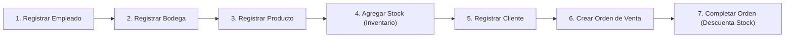
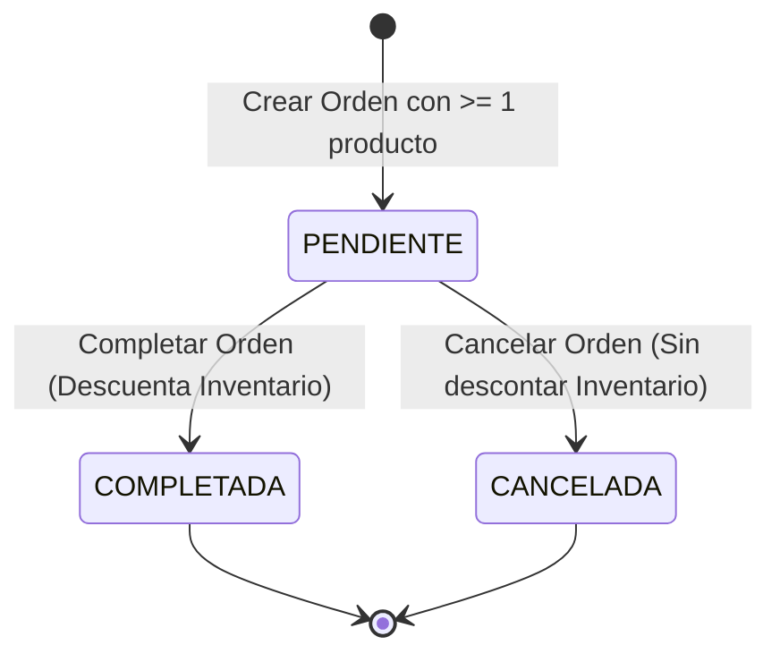

# MANUAL DE USUARIO
## Sistema Integral de Gestión de Ventas e Inventario (SVI)

---

**Documento:** Manual de Usuario y Operación del Sistema  
**Proyecto:** Sistema de Gestión de Ventas e Inventario Multidepósito (SVI)  
**Versión:** 1.0.0  
**Fecha:** Noviembre 2026  
**Lenguaje:** Java SE 17+ (LTS) con Interfaz Gráfica Swing  
**Público Objetivo:** Operadores comerciales, encargados de bodega, administradores y evaluadores académicos  

---

## 📋 Tabla de Contenidos
1. [Introducción y Objetivos del Sistema](#1-introducción-y-objetivos-del-sistema)
2. [Requisitos del Entorno e Instalación](#2-requisitos-del-entorno-e-instalación)
3. [Cómo Ejecutar la Aplicación](#3-cómo-ejecutar-la-aplicación)
   - [En Microsoft Windows (Doble Clic o Consola)](#31-en-microsoft-windows)
   - [En Linux / macOS](#32-en-linux--macos)
4. [Estructura y Elementos de la Interfaz Gráfica](#4-estructura-y-elementos-de-la-interfaz-gráfica)
5. [Flujo de Trabajo Recomendado](#5-flujo-de-trabajo-recomendado)
6. [Guía Operativa Módulo por Módulo](#6-guía-operativa-módulo-por-módulo)
   - [6.1 Módulo de Empleados](#61-módulo-de-empleados)
   - [6.2 Módulo de Bodegas](#62-módulo-de-bodegas)
   - [6.3 Módulo de Productos](#63-módulo-de-productos)
   - [6.4 Módulo de Inventario](#64-módulo-de-inventario)
   - [6.5 Módulo de Clientes](#65-módulo-de-clientes)
   - [6.6 Módulo de Ventas (Órdenes de Compra)](#66-módulo-de-ventas-órdenes-de-compra)
7. [Ciclo de Vida de las Órdenes de Compra](#7-ciclo-de-vida-de-las-órdenes-de-compra)
8. [Persistencia Automática y Respaldo de Datos](#8-persistencia-automática-y-respaldo-de-datos)
9. [Preguntas Frecuentes y Solución de Problemas](#9-preguntas-frecuentes-y-solución-de-problemas)

---

## 1. Introducción y Objetivos del Sistema

El **Sistema Integral de Gestión de Ventas e Inventario (SVI)** es una aplicación cliente de escritorio diseñada para administrar de manera confiable las operaciones de venta, almacenamiento en múltiples bodegas y control de inventario de una empresa comercial.

### Objetivos Clave:
- **Control Centralizado:** Administrar empleados, bodegas, catálogo de productos, clientes y existencias en un único entorno interactivo.
- **Trazabilidad Multidepósito:** Monitorear el stock de cada producto desglosado por cada bodega física.
- **Transacciones Seguras:** Asegurar que ninguna venta se procese sin stock suficiente y que el inventario se descuente de forma exacta e inmediata al completar la orden.
- **Persistencia Confiable:** Guardar automáticamente todos los datos en disco con mecanismos de respaldo para evitar pérdidas accidentales.

---

## 2. Requisitos del Entorno e Instalación

Para ejecutar el sistema en cualquier computadora, solo necesitas tener instalado **Java**:
- **Java SE Development Kit (JDK) o Java Runtime Environment (JRE):** Versión 17 LTS o 21 LTS.
- **Sistemas Operativos Soportados:**
  - Microsoft Windows 10 u 11 (64 bits).
  - macOS Monterey (12.0) o superior.
  - Linux (Ubuntu, Debian, Fedora, Arch, etc.).

### Verificación de Java en Windows:
Abre una terminal (`cmd` o `PowerShell`) y ejecuta:
```cmd
java -version
javac -version
```
Si aparece la versión de Java (ej. `openjdk version "21.0.x"`), el entorno está listo.

---

## 3. Cómo Ejecutar la Aplicación

### 3.1 En Microsoft Windows

#### Método 1: Doble Clic (Recomendado)
1. Localiza la carpeta del proyecto en el Explorador de Archivos de Windows.
2. Haz doble clic sobre el archivo **`run.bat`**.
3. El script compilará automáticamente los archivos si es la primera vez y abrirá de inmediato la ventana del sistema.

#### Método 2: Desde Símbolo del Sistema (`cmd`) o PowerShell
```cmd
cd ruta\hacia\sistemaventas
run.bat
```

> **Nota:** Si deseas únicamente compilar el proyecto sin iniciarlo, ejecuta **`build.bat`**. Si deseas ejecutar la batería de pruebas automatizadas, ejecuta **`test.bat`**.

---

### 3.2 En Linux / macOS

1. Abre la terminal en el directorio del proyecto.
2. Concede permisos de ejecución a los scripts:
   ```bash
   chmod +x run.sh build.sh test.sh
   ```
3. Inicia la aplicación:
   ```bash
   ./run.sh
   ```

---

## 4. Estructura y Elementos de la Interfaz Gráfica

La ventana principal del sistema (`VentanaPrincipal`) cuenta con un diseño ergonómico compuesto por tres áreas principales:

```text
+-----------------------------------------------------------------------------------+
|                     SISTEMA DE VENTAS E INVENTARIO (SVI)                          |
+-----------------------------------------------------------------------------------+
| [Productos]  [Clientes]  [Empleados]  [Bodegas]  [Inventario]  [Ventas]           | <- Pestañas Superiores
| +-------------------------------------------------------------------------------+ |
| | [Botón Acción 1]   [Botón Acción 2]   [Botón Acción 3]   ...                  | | <- Barra de Botones
| +-------------------------------------------------------------------------------+ |
+-----------------------------------------------------------------------------------+
|                                                                                   |
|  ÁREA DE SALIDA Y VISUALIZACIÓN EN TIEMPO REAL (CONSOLA MONOCROMÁTICA)             |
|                                                                                   |
|  CÓDIGO     | NOMBRE                    | MARCA        | PRECIO     | ...         |
|  -----------------------------------------------------------------------          |
|  PROD001    | Teclado Mecánico RGB      | Logitech     | Q  450.00  | ...         |
|  PROD002    | Monitor 27 Pulgadas IPS   | Dell         | Q 1850.00  | ...         |
|                                                                                   |
+-----------------------------------------------------------------------------------+
|                                                      [ Botón: Limpiar Consola ]   | <- Barra Inferior
+-----------------------------------------------------------------------------------+
```

1. **Pestañas de Navegación:** Permiten alternar entre los 6 módulos funcionales (`Productos`, `Clientes`, `Empleados`, `Bodegas`, `Inventario`, `Ventas`).
2. **Barra de Acciones:** Contiene los botones de registro (`Registrar`) y consulta (`Consultar`) propios de cada pestaña.
3. **Consola Central de Salida:** Muestra tablas formateadas con columnas alineadas, resúmenes de órdenes con desglose de productos y notificaciones del sistema.
4. **Botón "Limpiar Consola":** Ubicado en la esquina inferior derecha, permite vaciar la pantalla para tener una vista despejada.

---

## 5. Flujo de Trabajo Recomendado

Para comenzar a operar el sistema desde cero (datos nuevos), sigue este orden lógico:



1. **Registrar al menos un Empleado:** Toda bodega requiere un empleado responsable registrado previamente.
2. **Registrar una o más Bodegas:** Establece la capacidad de almacenamiento y vincula al empleado.
3. **Registrar Productos:** Define el catálogo con sus códigos, nombres y precios en Quetzales.
4. **Agregar Stock en Inventario:** Ingresa las unidades disponibles a las bodegas respetando su capacidad.
5. **Registrar Clientes:** Registra los clientes con su DPI de 13 dígitos y tipo (Regular o VIP).
6. **Crear y Procesar Ventas:** Emite órdenes de compra agregando productos desde las bodegas y complétalas para descontar el stock.

---

## 6. Guía Operativa Módulo por Módulo

### 6.1 Módulo de Empleados

Permite administrar el personal de la empresa que fungirá como responsables de las bodegas.

#### Pasos para Registrar un Empleado:
1. Haz clic en la pestaña **"Empleados"**.
2. Haz clic en el botón **"Registrar"**.
3. Se solicitarán secuencialmente los datos mediante ventanas emergentes:
   - **ID empleado:** Identificador alfanumérico único (ejemplo: `EMP01`).
   - **Nombre:** Nombre completo del trabajador (ejemplo: `Carlos Mendoza López`).
   - **DPI:** Código Único de Identificación de 13 dígitos numéricos (ejemplo: `1234567890101`).
   - **Dirección:** Ubicación de residencia (ejemplo: `Zona 10, Ciudad de Guatemala`).
   - **Puesto:** Cargo asignado (ejemplo: `Jefe de Almacén`).
   - **Salario en Q:** Salario mensual numérico (ejemplo: `4500.00`).
4. Si los datos son válidos, el sistema mostrará el mensaje de confirmación y actualizará automáticamente la consola.

#### Consulta de Empleados:
Haz clic en **"Consultar"** para ver la nómina organizada:
```text
=== EMPLEADOS REGISTRADOS ===
ID         | NOMBRE                    | DPI              | PUESTO             | SALARIO      | DIRECCIÓN
--------------------------------------------------------------------------------------------------------------
EMP01      | Carlos Mendoza López      | 1234567890101    | Jefe de Almacén    | Q4500.00     | Zona 10, Ciudad de Guatemala
EMP02      | Ana Sofía Morales         | 9876543210101    | Encargada Bodega   | Q3800.00     | Zona 1, Mixco
```

---

### 6.2 Módulo de Bodegas

Administra los depósitos físicos de mercancía y verifica su capacidad volumétrica máxima.

#### Pasos para Registrar una Bodega:
1. Haz clic en la pestaña **"Bodegas"** y luego en **"Registrar"**.
2. Completa los campos solicitados:
   - **ID bodega:** Identificador único (ejemplo: `BOD-CENTRAL`).
   - **ID del empleado responsable:** Debe coincidir con un empleado existente (ejemplo: `EMP01`).
   - **Capacidad total en unidades:** Número entero positivo que indica el stock máximo que soporta (ejemplo: `500`).
   - **Dirección:** Dirección física de la bodega (ejemplo: `Calzada Roosevelt 15-40, Zona 11`).
3. Haz clic en Aceptar.

#### Consulta de Bodegas con Ocupación en Tiempo Real:
Haz clic en **"Consultar"**. El sistema calcula automáticamente la ocupación actual:
```text
=== BODEGAS REGISTRADAS ===
ID BODEGA  | EMPLEADO RESPONSABLE        | OCUPACIÓN/CAP.  | DIRECCIÓN
-----------------------------------------------------------------------------------------------
BOD-CENTRAL| EMP01 (Carlos Mendoza López) | 120 / 500 un.   | Calzada Roosevelt 15-40, Zona 11
BOD-NORTE  | EMP02 (Ana Sofía Morales)    | 0 / 250 un.     | Km 14.5 Carretera al Atlántico
```

---

### 6.3 Módulo de Productos

Mantiene el catálogo de mercancías disponibles para la venta.

#### Pasos para Registrar un Producto:
1. Haz clic en la pestaña **"Productos"** y luego en **"Registrar"**.
2. Ingresa los datos:
   - **Código:** Código único de producto (ejemplo: `PROD01`).
   - **Nombre:** Denominación comercial (ejemplo: `Laptop Dell Inspiron 15`).
   - **Descripción:** Especificaciones breves (ejemplo: `Intel Core i7, 16GB RAM, 512GB SSD`).
   - **Marca:** Fabricante (ejemplo: `Dell`).
   - **Precio en Q:** Valor de venta unitario (ejemplo: `6500.00`).
3. El sistema valida que el precio sea mayor que cero y redondea a 2 decimales.

#### Consulta del Catálogo de Productos:
Haz clic en **"Consultar"**:
```text
=== CATÁLOGO DE PRODUCTOS ===
CÓDIGO     | NOMBRE                    | MARCA              | PRECIO       | DESCRIPCIÓN
-----------------------------------------------------------------------------------------------
PROD01     | Laptop Dell Inspiron 15   | Dell               | Q6500.00     | Intel Core i7, 16GB RAM, 512GB SSD
PROD02     | Mouse Inalámbrico Pro     | Logitech           | Q225.50      | Sensor óptico 4000 DPI USB
```

---

### 6.4 Módulo de Inventario

Controla el ingreso físico de unidades a cada bodega y supervisa que no se rebase la capacidad máxima permitida.

#### Pasos para Agregar Stock:
1. Haz clic en la pestaña **"Inventario"** y selecciona **"Agregar stock"**.
2. Ingresa:
   - **Código del producto:** Ejemplo: `PROD01`.
   - **ID de bodega:** Ejemplo: `BOD-CENTRAL`.
   - **Cantidad a ingresar:** Número entero mayor que cero (ejemplo: `50`).
3. **Validación Automática:** Si la cantidad supera el cupo libre de la bodega, el sistema cancelará la operación y notificará el exceso:
   > *"La cantidad supera la capacidad de la bodega. (Capacidad máxima: 500, Ocupación actual: 480, Intentas ingresar: 50)"*
4. Si hay espacio suficiente, el stock se almacena inmediatamente.

#### Consulta de Inventario:
Haz clic en **"Consultar"**:
```text
=== INVENTARIO (EXISTENCIAS EN BODEGAS) ===
CÓD. PROD.   | NOMBRE PRODUCTO           | ID BODEGA    | STOCK     
----------------------------------------------------------------------
PROD01       | Laptop Dell Inspiron 15   | BOD-CENTRAL  | 50        
PROD02       | Mouse Inalámbrico Pro     | BOD-CENTRAL  | 70        
PROD01       | Laptop Dell Inspiron 15   | BOD-NORTE    | 25        
```

---

### 6.5 Módulo de Clientes

Registra los compradores y sus clasificaciones comerciales.

#### Pasos para Registrar un Cliente:
1. Haz clic en la pestaña **"Clientes"** y selecciona **"Registrar"**.
2. Completa los campos:
   - **DPI:** 13 dígitos numéricos exactos (ejemplo: `2485963210101`).
   - **Nombre completo:** Ejemplo: `María René Estrada`.
   - **Dirección:** Ejemplo: `Avenida Las Américas, Zona 14`.
   - **Fecha de nacimiento:** Formato obligatorio `AAAA-MM-DD` (ejemplo: `1992-08-15`).
   - **Tipo de cliente:** Selecciona mediante el diálogo entre **Regular** o **VIP**.
3. Haz clic en Guardar.

#### Consulta de Clientes:
Haz clic en **"Consultar"**:
```text
=== CLIENTES REGISTRADOS ===
DPI              | NOMBRE COMPLETO           | TIPO       | FECHA NAC.   | DIRECCIÓN
-----------------------------------------------------------------------------------------------
2485963210101    | María René Estrada        | VIP        | 1992-08-15   | Avenida Las Américas, Zona 14
3012457890101    | Jorge Mario Gómez         | Regular    | 1985-03-22   | 5ta Avenida 10-20, Zona 1
```

---

### 6.6 Módulo de Ventas (Órdenes de Compra)

El módulo de ventas permite generar transacciones multirrenglón, reservar mercancía y liquidar las operaciones comerciales.

#### 1. Creación de una Nueva Orden:
1. Haz clic en la pestaña **"Ventas"** y presiona **"Crear orden"**.
2. Ingresa el **DPI del cliente** comprador. Si no existe, el sistema te solicitará registrarlo primero.
3. Se generará un identificador único con prefijo `ORD-` (ej. `ORD-E3F4A812`).
4. A continuación, entrarás en el ciclo interactivo de adición de productos:
   - Ingresa el **Código del Producto** (ej. `PROD01`).
   - Ingresa el **ID de la Bodega** desde donde se despachará (ej. `BOD-CENTRAL`). El sistema te informará el stock disponible en esa ubicación.
   - Ingresa la **Cantidad a comprar**.
   - Si la cantidad está disponible, se añadirá a la orden y se mostrará el subtotal acumulado.
5. El sistema preguntará: *¿Deseas agregar otro producto a esta orden?*:
   - Si presionas **Sí**, repites el paso para agregar más productos de la misma o de otra bodega.
   - Si presionas **No**, finalizas la carga de ítems.
6. **Opción de Liquidación Inmediata:**
   - Si respondes **Sí** a *¿Deseas COMPLETAR la venta ahora mismo?*, la orden pasa a estado `COMPLETADA` y el stock se descuenta en el acto.
   - Si respondes **No**, la orden queda en estado `PENDIENTE` para ser completada o cancelada con posterioridad.

> **Protección contra Órdenes Fantasma:** Si durante la creación de la orden cancelas el proceso sin haber añadido ningún producto, el sistema eliminará automáticamente el borrador vacío para evitar registros basura en tu historial.

---

#### 2. Completar una Orden Pendiente:
1. En la pestaña **"Ventas"**, presiona **"Completar orden"**.
2. El sistema filtrará y desplegará en una lista **únicamente las órdenes en estado PENDIENTE**.
3. Selecciona la orden deseada y pulsa Aceptar.
4. El sistema verificará nuevamente que exista stock en las bodegas indicadas, descontará las existencias y marcará la orden como `COMPLETADA`.

---

#### 3. Cancelar una Orden:
1. En la pestaña **"Ventas"**, presiona **"Cancelar orden"**.
2. Selecciona la orden pendiente de la lista.
3. La orden pasará a estado `CANCELADA`. **El inventario no se verá afectado** (no se resta mercancía).

---

#### 4. Consulta de Historial de Órdenes:
Haz clic en el botón **"Consultar"** en la pestaña de Ventas para obtener un reporte completo con desglose de renglones:
```text
=== HISTORIAL DE ÓRDENES Y VENTAS ===

ORDEN ID: ORD-E3F4A812 | Fecha: 2026-11-06 | Estado: [COMPLETADA] | Total: Q13225.50
Cliente : 2485963210101 - María René Estrada
Detalle de productos:
   • PROD01   (Laptop Dell Inspiron 15) | Bodega: BOD-CENTRAL | Cant: 2    @ Q6500.00 = Q13000.00
   • PROD02   (Mouse Inalámbrico Pro)   | Bodega: BOD-CENTRAL | Cant: 1    @ Q225.50  = Q225.50
--------------------------------------------------------------------------------
ORDEN ID: ORD-89A12BC4 | Fecha: 2026-11-06 | Estado: [PENDIENTE] | Total: Q450.00
Cliente : 3012457890101 - Jorge Mario Gómez
Detalle de productos:
   • PROD02   (Mouse Inalámbrico Pro)   | Bodega: BOD-NORTE   | Cant: 2    @ Q225.50  = Q450.00
--------------------------------------------------------------------------------
```

---

## 7. Ciclo de Vida de las Órdenes de Compra



- **`PENDIENTE`:** La orden ha sido creada y tiene productos asignados. El stock aún no ha sido restado del inventario físico de las bodegas.
- **`COMPLETADA`:** Transacción liquidada con éxito. El inventario fue descontado de forma definitiva en las bodegas correspondientes.
- **`CANCELADA`:** Operación anulada comercialmente. No se modifica ninguna existencia en bodega.

---

## 8. Persistencia Automática y Respaldo de Datos

Toda modificación realizada en el sistema (registros, adición de stock, órdenes completadas) se guarda **de inmediato y de manera transparente** en la carpeta `datos/`:
- **`datos/sistema.dat`:** Archivo binario principal que contiene todo el estado del sistema.
- **`datos/sistema.bak`:** Copia de respaldo generada automáticamente antes de cada modificación.
- **`datos/sistema.tmp`:** Archivo temporal utilizado durante el guardado para garantizar atomicidad y prevenir corrupción de datos si el equipo se apaga repentinamente.

> **Autorrecuperación:** Si por alguna falla externa el archivo principal `sistema.dat` se daña o se interrumpe abruptamente su escritura, el sistema detectará el incidente y restaurará automáticamente la información desde `sistema.bak`.

---

## 9. Preguntas Frecuentes y Solución de Problemas

### 1. ¿Qué hago si al iniciar dice "No se pudo iniciar el sistema"?
Asegúrate de tener permisos de lectura y escritura en la carpeta donde descomprimiste el proyecto. El sistema necesita crear la subcarpeta `datos/`.

### 2. ¿Por qué no me deja registrar una bodega?
Porque toda bodega requiere obligatoriamente el ID de un empleado responsable. Registra primero al menos un empleado en la pestaña **"Empleados"**.

### 3. ¿Qué ocurre si intento ingresar más stock del que soporta una bodega?
El sistema tiene un control matemático estricto. Si la suma del stock actual más lo que intentas agregar supera la capacidad definida de la bodega, la operación se rechazará para evitar sobreocupación.

### 4. ¿Por qué no puedo completar una orden?
Existen dos motivos posibles:
- **No tiene productos:** Una orden debe tener al menos un producto para poder ser completada.
- **Stock insuficiente al momento de completar:** Si otra orden consumió previamente el stock disponible de esa bodega, deberás abastecerla en la pestaña **"Inventario"** antes de completar la venta.

### 5. ¿Cómo limpio la pantalla de salida?
Presiona el botón **"Limpiar Consola"** situado en la esquina inferior derecha de la ventana principal.
